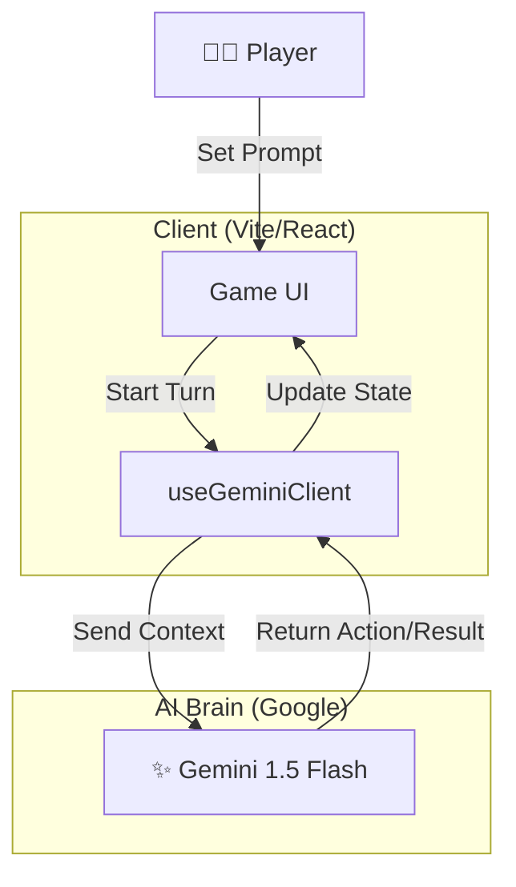

# Jisou no Kai (自走の会) - AI Auto-Battle Arena ⚔️

<p align="center">
  <b>「AIが思考し、AIが戦う。プレイヤーは『プロンプト』で指揮を執る」</b><br>
  Strategize with Prompts, Watch AI Battle it out.
</p>


---

## 📖 概要 (Overview)

**Jisou no Kai** は、プレイヤーがキャラクターを直接操作するのではなく、**「行動指針（プロンプト）」** を与えることで戦わせる、新しいタイプのオートバトルゲームです。
Google Gemini APIを活用し、毎ターンの行動決定、攻撃描写、そして勝敗判定まで全てをAIがリアルタイムに生成。
「最強の指示」を見つけ出す、プロンプトエンジニアリング×RPGの融合を目指しています。

## ✨ 主な機能 (Planned Features)

### 1. 🧠 Prompt Coaching (指揮)
* プレイヤーはキャラに「勇敢に戦え」や「相手の隙を見つけろ」といった指示（プロンプト）を設定。
* AIはその指示に従って毎ターンの行動を決定します。

### 2. ⚡ LLM-Driven Battles (AI戦闘)
* **概要:** ダメージ計算だけでなく、「どのように攻撃したか」「相手はどう避けたか」というナラティブ（物語）をAIが生成。
* **技術:** `Gemini 1.5 Flash` による高速レスポンスで、テキストベースながら臨場感のあるバトルを展開。

### 3. 🛡️ Attribute & Skills
* キャラクターの属性（火・水・風など）やスキルセットも、AIが解釈して戦闘結果に反映させます。

---

## 🛠 技術スタック (Tech Stack)

| Category | Technology | Usage |
| :--- | :--- | :--- |
| **Frontend** | **Vite + React** | 高速なWebアプリケーションフレームワーク |
| **Language** | **TypeScript** | 堅牢な型システム |
| **AI Model** | **Google Gemini 1.5** | ゲームマスター/戦闘シミュレーション |
| **State** | **Zustand** | 軽量な状態管理 |
| **Styling** | **Tailwind CSS** | ユーティリティファーストなスタイリング |

---

## 🏗️ アーキテクチャ (Architecture)



---

## 🚀 セットアップ (Getting Started)

### Prerequisites
* Node.js 18+
* Google Gemini API Key

### Installation

1. Clone the repository:
   ```bash
   git clone https://github.com/naki0227/jisou_no_kai.git
   cd jisou_no_kai
   ```

2. Install dependencies:
   ```bash
   npm install
   ```

3. Set up environment:
   Create `.env`:
   ```env
   VITE_GEMINI_API_KEY=your_api_key
   ```

4. Run:
   ```bash
   npm run dev
   ```

---

## 👨‍💻 開発者 (Developer)
**Enludus**

Focus: AI x Game Design
Contact: <https://enludus.vercel.app>

<p align="center"> 
    © 2025 Jisou no Kai Project. All rights reserved. 
</p>
